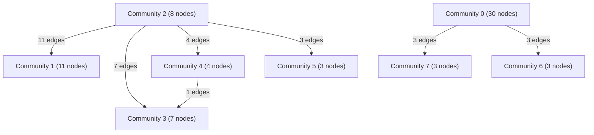

# Knowledge Graph Index

> Auto-generated by graphify. Start here — read community articles for context, then drill into god nodes for detail.

**69 nodes · 102 edges · 8 communities**

---

## System Architecture Flowchart

## Communities
(sorted by size, largest first)

- [[Community 0]] — 30 nodes
- [[Community 1]] — 11 nodes
- [[Community 2]] — 8 nodes
- [[Community 3]] — 7 nodes
- [[Community 4]] — 4 nodes
- [[Community 5]] — 3 nodes
- [[Community 6]] — 3 nodes
- [[Community 7]] — 3 nodes

## God Nodes
(most connected concepts — the load-bearing abstractions)

- [[expenses()]] — 7 connections
- [[sessions()]] — 6 connections
- [[users()]] — 5 connections
- [[normalizeExpense()]] — 5 connections
- [[publicExpense()]] — 5 connections
- [[getUserBySession()]] — 4 connections
- [[createExpense()]] — 4 connections
- [[updateExpense()]] — 4 connections
- [[hashToken()]] — 4 connections
- [[budgets()]] — 3 connections

---

*Generated by [graphify](https://github.com/safishamsi/graphify)*