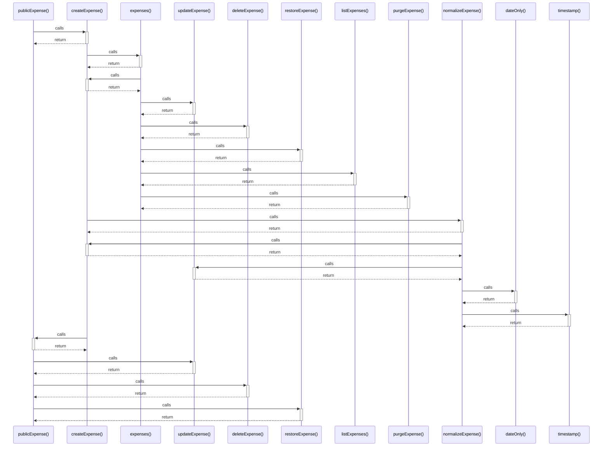

# publicExpense()

> God node · 5 connections · [D:\Projects\react\paisa_wise\server\db.js](file:///D:/Projects/react/paisa_wise/server/db.js#L309)

## Call Trace Diagram

## Connections by Relation

### calls
- [[createExpense()]] `EXTRACTED`
- [[updateExpense()]] `EXTRACTED`
- [[deleteExpense()]] `EXTRACTED`
- [[restoreExpense()]] `EXTRACTED`

### contains
- [[db.js]] `EXTRACTED`

---

*Part of the graphify knowledge wiki. See [[index]] to navigate.*