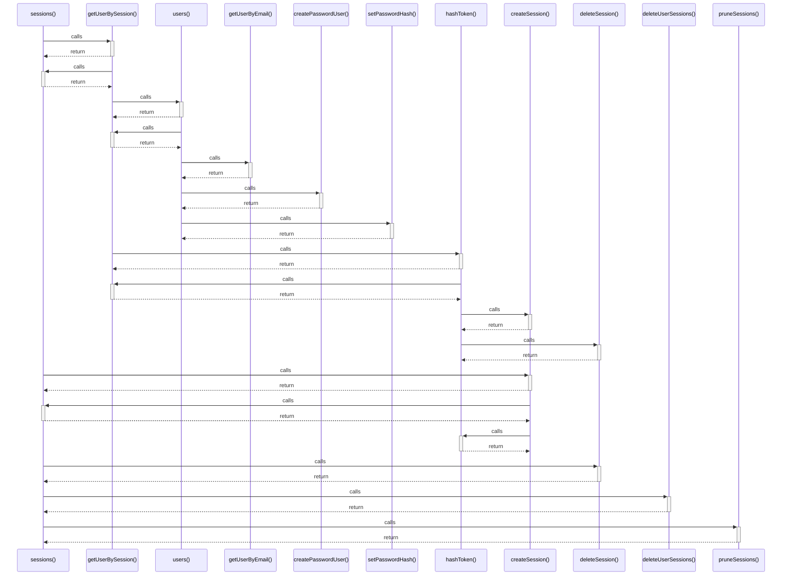

# sessions()

> God node · 6 connections · [D:\Projects\react\paisa_wise\server\db.js](file:///D:/Projects/react/paisa_wise/server/db.js#L62)

## Call Trace Diagram

## Connections by Relation

### calls
- [[getUserBySession()]] `EXTRACTED`
- [[createSession()]] `EXTRACTED`
- [[deleteSession()]] `EXTRACTED`
- [[deleteUserSessions()]] `EXTRACTED`
- [[pruneSessions()]] `EXTRACTED`

### contains
- [[db.js]] `EXTRACTED`

---

*Part of the graphify knowledge wiki. See [[index]] to navigate.*