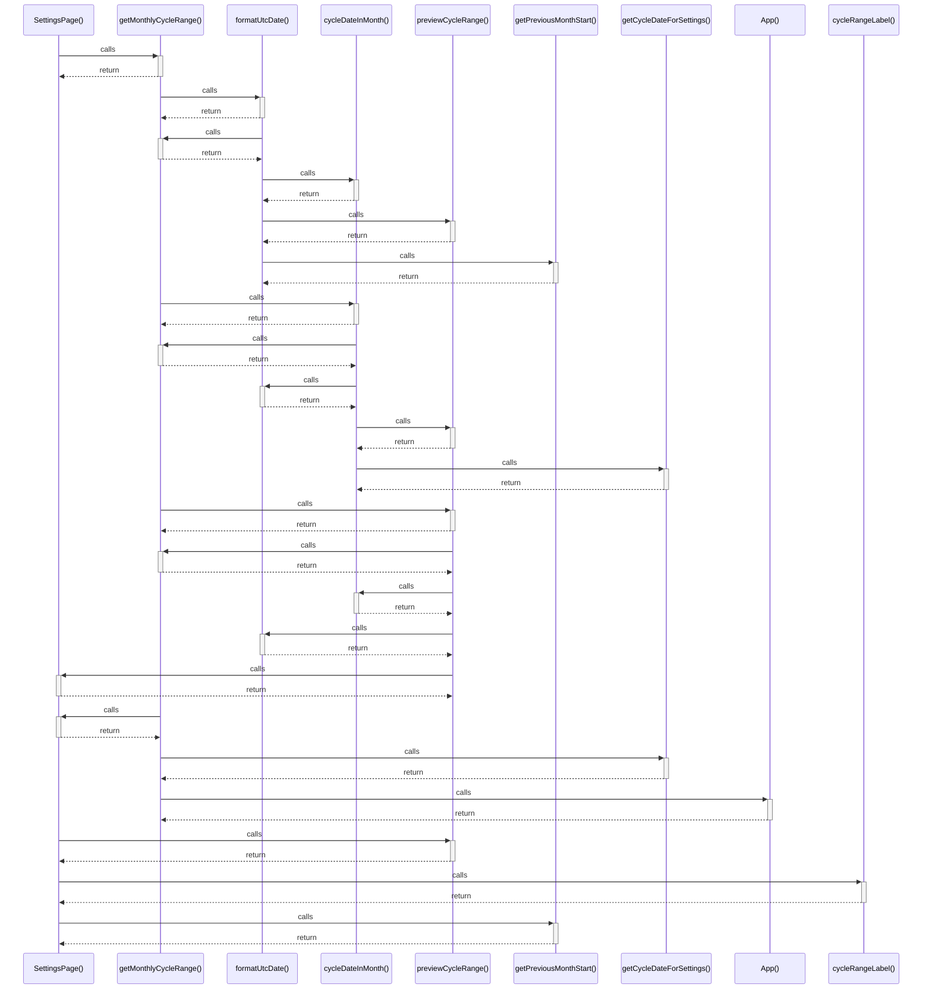

# SettingsPage()

> God node · 5 connections · [D:\Projects\react\paisa_wise\src\pages\SettingsPage.jsx](file:///D:/Projects/react/paisa_wise/src/pages/SettingsPage.jsx#L7)

## Call Trace Diagram

## Connections by Relation

### calls
- [[getMonthlyCycleRange()]] `INFERRED`
- [[previewCycleRange()]] `INFERRED`
- [[cycleRangeLabel()]] `INFERRED`
- [[getPreviousMonthStart()]] `INFERRED`

### contains
- [[SettingsPage.jsx]] `EXTRACTED`

---

*Part of the graphify knowledge wiki. See [[index]] to navigate.*