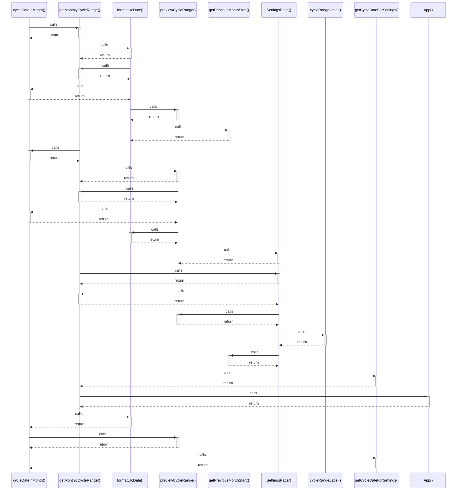

# cycleDateInMonth()

> God node · 5 connections · [D:\Projects\react\paisa_wise\src\utils\appData.js](file:///D:/Projects/react/paisa_wise/src/utils/appData.js#L29)

## Call Trace Diagram

## Connections by Relation

### calls
- [[getMonthlyCycleRange()]] `EXTRACTED`
- [[formatUtcDate()]] `EXTRACTED`
- [[previewCycleRange()]] `EXTRACTED`
- [[getCycleDateForSettings()]] `EXTRACTED`

### contains
- [[appData.js]] `EXTRACTED`

---

*Part of the graphify knowledge wiki. See [[index]] to navigate.*