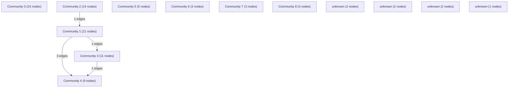

# Knowledge Graph Index

> Auto-generated by graphify. Start here — read community articles for context, then drill into god nodes for detail.

**100 nodes · 127 edges · 13 communities**

---

## System Architecture Flowchart

## Communities
(sorted by size, largest first)

- [[Community 0]] — 24 nodes
- [[Community 1]] — 21 nodes
- [[Community 2]] — 14 nodes
- [[Community 3]] — 11 nodes
- [[Community 4]] — 9 nodes
- [[Community 5]] — 5 nodes
- [[Community 6]] — 3 nodes
- [[Community 7]] — 3 nodes
- [[Community 8]] — 3 nodes
- [[unknown]] — 2 nodes
- [[unknown]] — 2 nodes
- [[unknown]] — 2 nodes
- [[unknown]] — 1 nodes

## God Nodes
(most connected concepts — the load-bearing abstractions)

- [[queue()]] — 8 connections
- [[request()]] — 7 connections
- [[getMonthlyCycleRange()]] — 7 connections
- [[SettingsPage()]] — 5 connections
- [[formatUtcDate()]] — 5 connections
- [[cycleDateInMonth()]] — 5 connections
- [[previewCycleRange()]] — 5 connections
- [[money()]] — 5 connections
- [[normalizeExpense()]] — 4 connections
- [[addExpense()]] — 4 connections

---

*Generated by [graphify](https://github.com/safishamsi/graphify)*