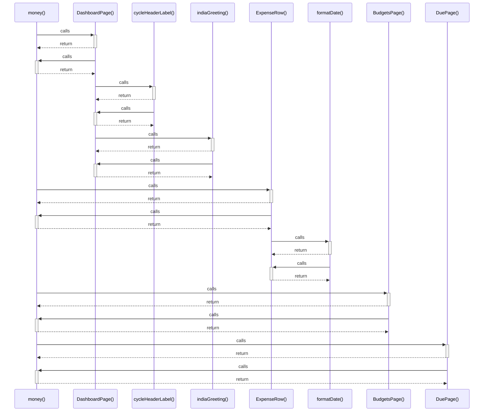

# money()

> God node · 5 connections · [D:\Projects\react\paisa_wise\src\utils\appData.js](file:///D:/Projects/react/paisa_wise/src/utils/appData.js#L87)

## Call Trace Diagram

## Connections by Relation

### calls
- [[DashboardPage()]] `INFERRED`
- [[ExpenseRow()]] `INFERRED`
- [[BudgetsPage()]] `INFERRED`
- [[DuePage()]] `INFERRED`

### contains
- [[appData.js]] `EXTRACTED`

---

*Part of the graphify knowledge wiki. See [[index]] to navigate.*