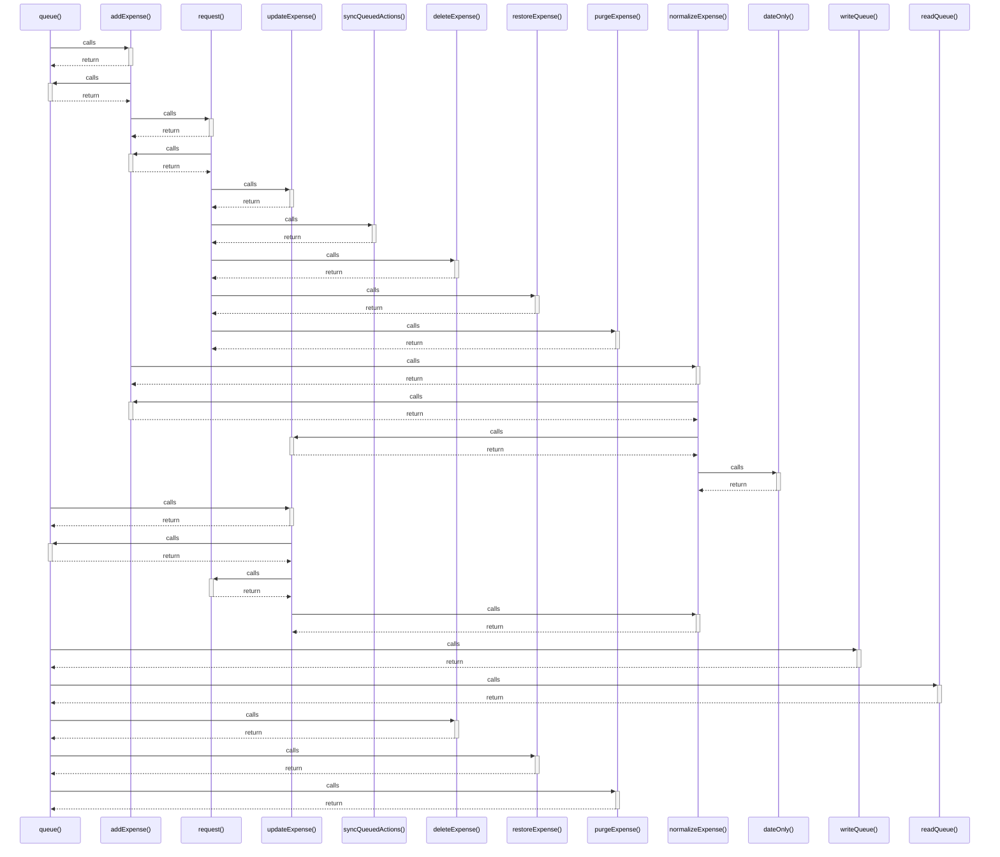

# queue()

> God node · 8 connections · [D:\Projects\react\paisa_wise\src\api\expensesApi.js](file:///D:/Projects/react/paisa_wise/src/api/expensesApi.js#L42)

## Call Trace Diagram

## Connections by Relation

### calls
- [[addExpense()]] `EXTRACTED`
- [[updateExpense()]] `EXTRACTED`
- [[writeQueue()]] `EXTRACTED`
- [[readQueue()]] `EXTRACTED`
- [[deleteExpense()]] `EXTRACTED`
- [[restoreExpense()]] `EXTRACTED`
- [[purgeExpense()]] `EXTRACTED`

### contains
- [[expensesApi.js]] `EXTRACTED`

---

*Part of the graphify knowledge wiki. See [[index]] to navigate.*